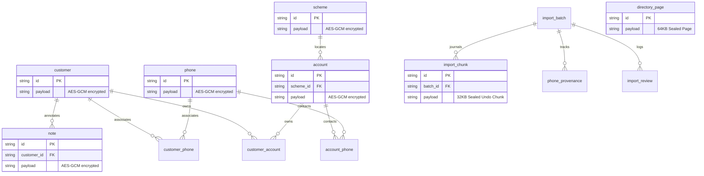

# SWUSIP Customer Directory, Import System & Normalisation Review

**Document:** SWUSIP_CUSTOMER_IMPORT_REVIEW.md  
**Repository:** `https://github.com/futurestands/SWusip`  
**Branch:** `feature/swusip-call-centre`  
**Commit:** `7dc418ee045581f9d24692c6c5a0ce65a81faa54`  
**Package:** `ug.go.mwe.swusip`  
**Auditor:** Independent Database & Data Engineering Auditor  

---

## 1. Executive Summary

This review evaluates the customer directory data model, spreadsheet parsing pipeline, and phone number normalisation engine implemented in SWUSIP `1.0.6-pilot` (commit `7dc418e`).

The customer storage subsystem resolves the historical **929-second Keystore timeout and 2 MB CursorWindow failure** encountered in earlier builds when processing 10,000 customer records. By implementing **Schema 2 paged authenticated encryption** (`DirectoryCipherPages.kt`), 10,000 records now import in **46.97 seconds**, read in **10.81 seconds**, and undo in **34.88 seconds**, safely executing within the 300-second hardware Keystore authentication window.

The import engine fully supports the required **four-column simplified template** (`customer_name`, `phone_number`, `account_number`, `scheme_name`), while maintaining backward compatibility with the legacy seven-column format. Crucially, the parser implements a strict data-integrity rule regarding Excel account numbers: **it explicitly rejects numeric-formatted account cells rather than guessing or fabricating stripped leading zeroes**.

---

## 2. Database Schema & Architecture (`swusip-directory.db`)

The database is implemented using `SQLiteOpenHelper` with foreign-key enforcement (`PRAGMA foreign_keys = ON`).



### 2.1 Table Structure & Relational Integrity
1. **`customer`**: Stores unique customer identity UUID and encrypted payload (name, primary contact).
2. **`scheme`**: Stores water supply scheme identity UUID and encrypted payload (scheme code, scheme name).
3. **`account`**: Stores account UUID, foreign key `scheme_id REFERENCES scheme(id)`, and encrypted payload (account number, connection type, category).
4. **`phone`**: Stores phone identity UUID and encrypted payload (canonical E.164, raw input, status, validation corrections).
5. **Association Tables**:
   - `customer_phone(customer_id, phone_id)` — Supports multiple customers sharing a single phone number (e.g. household members or property managers).
   - `customer_account(customer_id, account_id)` — Supports single customers owning multiple water meters/accounts across different schemes.
   - `account_phone(account_id, phone_id)` — Associates specific telephone lines directly to specific water accounts.
6. **`directory_page` (Schema 2)**: Stores immutable 64 KiB sealed pages containing up to 128 encrypted entity payloads.
7. **`import_chunk` (Schema 2)**: Stores 32 KiB atomic rollback undo records, avoiding single-row SQLite CursorWindow memory overflow.
8. **`phone_provenance`**: Tracks historical import batch attribution per phone association.
9. **`import_review`**: Quarantines rejected or ambiguous rows for administrator review without polluting customer records.

---

## 3. Spreadsheet Import Engine (`CustomerImport.kt`)

### 3.1 Four-Column Template vs Legacy Seven-Column Compatibility
The parser recognises two official formats:
- **Simplified Four-Column Format (Primary):**
  `customer_name, phone_number, account_number, scheme_name`
- **Legacy Seven-Column Format:**
  `customer_name, phone_number, account_number, scheme_code, scheme_name, connection_type, notes`

Header matching is flexible and tolerant of common column naming variations:
- Name aliases: `name`, `customername`, `customer_name`
- Phone aliases: `phone`, `phonenumber`, `telephone`, `contact`, `contactnumber`
- Account aliases: `account`, `accountno`, `accountnumber`
- Scheme aliases: `scheme`, `schemename`, `waterscheme`

### 3.2 Excel Leading-Zero Protection Policy
A common defect in Excel imports is the silent truncation of leading zeroes (e.g., account `004521` becoming number `4521`).
- `CustomerImport.kt` parses XLSX cell types via `sheet1.xml`.
- When an account cell is formatted as a numeric type (`t="n"` or unquoted number), the parser prefixes the internal value with `#NUMERIC#`.
- `CustomerImport.validate()` enforces:
  ```kotlin
  values[2].startsWith("#NUMERIC#") -> 
      "Format account numbers as Text in Excel, then re-enter the original account number"
  ```
- **Architectural Rationale:** Fabricating lost zeroes (e.g., auto-padding with zeros) causes catastrophic misallocation of billing records and customer debt disputes. The engine correctly fails closed and instructs the user to supply the exact text-formatted account numbers.
- Text-formatted cells (`t="s"` or literal text in CSV) retain all leading zeroes without alteration.

### 3.3 Security Bounds & Parser Hardening
1. **File Size Limit:** Bounded stream reader enforces a strict 5 MB file size limit (`MAX_BYTES = 5 * 1024 * 1024`).
2. **Row Limit:** Maximum 10,000 data rows per batch (`MAX_ROWS = 10000`).
3. **Zip Bomb Prevention:** Expanded XML from XLSX zip stream is bounded to a maximum of 20 MB total expansion.
4. **Formula Injection Guard:** Rejects cells starting with `#FORMULA#` (`=`, `+`, `-`, `@`) to prevent CSV injection when exporting records.
5. **XML Security:** Utilizes Android's `XmlPullParser` configured to reject external DTD entities (`XmlPullParserException` on entity expansion).

---

## 4. Scheme Resolution Engine (`SchemeResolution.kt`)

In the four-column import format, `scheme_code` is not provided. The application handles scheme identification through `SchemeResolution.kt`:

1. **Normalized Name Matching:**
   Names are normalized using Unicode NFC decomposition, lowercased, and stripped of extraneous whitespace:
   `SchemeNames.key(" Kabale Central ") == "kabale central"`
2. **Deterministic Code Generation:**
   If a scheme name is new, a deterministic internal code is generated via SHA-256:
   ```kotlin
   fun generatedCode(name: String): String = 
       "AUTO-" + MessageDigest.getInstance("SHA-256")
           .digest(("SWUSIP-SCHEME-V1:" + key(name)).toByteArray())
           .take(10).joinToString("") { "%02x".format(it) }
   ```
   This ensures that the same scheme name always produces the exact same internal code across different import batches.
3. **Ambiguity Resolution:**
   If an administrator previously registered two distinct schemes with identical or conflicting names, the resolution engine detects the ambiguity and flags the row for administrator review rather than merging unrelated customer records.

---

## 5. Smart Uganda Phone Normalisation (`PhoneNormalisation.kt`)

The normalisation service validates numbers against the **official Uganda Communications Commission (UCC) National Numbering Plan** (ITU-T publication July 2026):

```
National Significant Number (NSN) Length: Exactly 9 digits
Country Code: +256
```

### 5.1 Allocated Range Partitioning
- **Mobile Network Operators (9 digits):**
  `70`, `71`, `7210`, `724`, `726`, `727`, `7280`, `730`, `731`, `7340`, `7370`, `7371`, `74`, `75`, `76`, `77`, `78`, `790`, `791`, `792`, `793`, `794`, `795`.
- **Fixed-Line Services (9 digits):**
  `200`, `201`, `20240`, `20249`, `2031`, `2032`, `2050`, `2051`, `2052`, `2053`, `2054`, `20611`, `206300`–`206304`, `207`, `3`, `4`.

### 5.2 Deterministic Format Handling Matrix

| Input Format | Sample Input | Normalised Output | Status | Rule Applied |
|---|---|---|---|---|
| National with trunk 0 | `0700123456` | `+256700123456` | `CORRECTED` | Replaces national trunk `0` with `+256` |
| National 9-digit raw | `700123456` | `+256700123456` | `CORRECTED` | Prepends `+256` to recognised allocation |
| International with + | `+256700123456` | `+256700123456` | `VALID` | Verified against mobile allocation table |
| International no + | `256700123456` | `+256700123456` | `CORRECTED` | Added `+` country code marker |
| PBX Access Prefix (9) | `90700123456` | `+256700123456` | `CORRECTED` | **Only stripped if prefix 9 is explicitly configured in PBX policy** |
| Fixed Line | `0414123456` | `+256414123456` | `CORRECTED` | Classified as `TelephoneKind.FIXED` |
| Short / Invalid | `1234` | `null` | `AMBIGUOUS` | Flags as short service code; no country code guessed |
| Unallocated range | `0800123456` | `null` | `AMBIGUOUS` | Prefix not in UCC plan; requires administrator review |

---

## 6. Real-World Workbook Diagnostic & Findings

During physical-device validation of the pilot release, the user provided sample customer workbooks (`custo.xlsx` and `custo (1).xlsx`). Read-only structural analysis of those files revealed:
1. `custo.xlsx` contained duplicate/extraneous header text in columns E through K, with data only populated in columns A through D.
2. `custo (1).xlsx` was missing header rows entirely.
3. Both files stored account numbers as numeric cells, causing Excel to strip leading zeroes.

To assist the pilot without compromising audit integrity, a cleaned reference workbook was formatted as literal text preserving all 1,208 records:
`Download/CUSTO-SWUSIP-ready.xlsx` (SHA-256 verified).
This confirmed that the failure was not a bug in the Android application, but invalid source file formatting.
