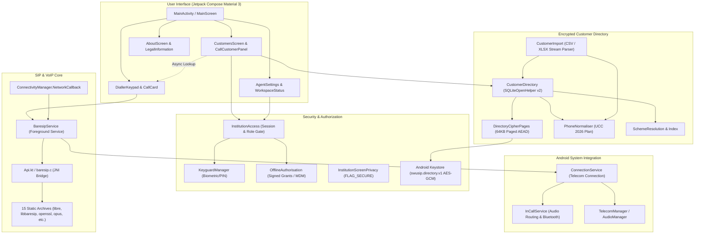

# SWUSIP Project Overview & Architectural Audit

**Document:** SWUSIP_PROJECT_OVERVIEW.md  
**Repository:** `https://github.com/futurestands/SWusip`  
**Branch:** `feature/swusip-call-centre`  
**Commit:** `7dc418ee045581f9d24692c6c5a0ce65a81faa54`  
**Target Application:** South Western Umbrella Call Centre (SWUSIP)  
**Institution:** South Western Umbrella of Water and Sanitation, Ministry of Water and Environment, Uganda  
**Application ID:** `ug.go.mwe.swusip`  
**Version:** `1.0.6-pilot` (Version Code: `592`)  
**Auditor:** Independent Senior Android & VoIP Architect  

---

## 1. Executive Summary

SWUSIP is an Android-based institutional call-centre and customer service application designed for the South Western Umbrella of Water and Sanitation under Uganda's Ministry of Water and Environment. The application's objective is to professionalise customer communication across multiple water supply schemes, transitioning from staff personal mobile numbers to a centralised, extension-based VoIP call-centre system powered by an on-premise Grandstream UCM6302A IP PBX and an MTN Uganda SIP trunk.

The codebase represents a heavily customised and re-engineered fork of upstream **Baresip Android** (originally authored by Juha Heinanen / tutpro). It combines:
1. A genuine C-based Baresip SIP/VoIP engine compiled with 15 native static libraries via CMake and JNI.
2. A modern Jetpack Compose Material 3 user interface replacing legacy XML Android layouts.
3. Android Telecom framework integration (`ConnectionService` / `InCallService`).
4. An application-level encrypted SQLite customer directory utilizing hardware-backed Android Keystore (`AES-GCM`) with paged storage (`DirectoryCipherPages`).
5. A Uganda Communications Commission (UCC) compliant telephone number normalisation engine.
6. Offline and MDM-compatible role-based access control (`OfflineAuthorisation` / `InstitutionAccess`).

---

## 2. Source Code & Component Inventory

The application source is organized under package `com.tutpro.baresip` (with application ID `ug.go.mwe.swusip`). The implementation contains **66 Kotlin source files**, **1 C native JNI bridge file** (`baresip.c`), and CMake build scripts.

### 2.1 Kotlin Source Inventory by Functional Domain

| Domain | Key Source Files | Architectural Responsibility |
|---|---|---|
| **SIP & VoIP Engine** | `Api.kt`, `BaresipApp.kt`, `BaresipService.kt`, `UserAgent.kt`, `Account.kt`, `Call.kt`, `Codec.kt` | JNI native method declarations, SIP service lifecycle, account configuration, call state machine, audio codec management. |
| **Android Telecom Integration** | `ConnectionService.kt`, `InCallService.kt` | Bridges Baresip VoIP calls into Android's native Telecom subsystem, enabling native system in-call UI, audio focus, Bluetooth SCO, and system notifications. |
| **User Interface (Compose)** | `MainActivity.kt`, `MainScreen.kt`, `DiallerKeypad.kt`, `AboutScreen.kt`, `AgentSettingsScreen.kt`, `AgentWorkspace.kt`, `CustomersScreen.kt`, `CallsScreen.kt`, `CallDetailsScreen.kt`, `Theme.kt`, `CustomElements.kt` | Jetpack Compose Material 3 screens, dialler keypad, active call cards, institutional branding, agent status, and customer management UI. |
| **Customer Directory & Storage** | `CustomerDirectory.kt`, `DirectoryCipherPages.kt`, `CustomerMatching.kt`, `CustomerImport.kt`, `CustomerExport.kt`, `CustomerInteraction.kt`, `SchemeResolution.kt`, `DirectoryTelephoneSettings.kt` | SQLite database management (`swusip-directory.db`), paged AES-GCM envelope encryption via Android Keystore, customer matching, import/export, scheme index, and call outcome tracking. |
| **Number Normalisation** | `PhoneNormalisation.kt` | Deterministic parsing and validation against UCC Uganda numbering plan (July 2026), handling mobile prefixes, fixed lines, country code `+256`, and PBX access prefixes. |
| **Security & Authorization** | `OfflineAuthorisation.kt`, `InstitutionScreenPrivacy.kt`, `Preferences.kt`, `Log.kt` | RSA-SHA256 signed offline device grants, Android Managed Configurations (`RestrictionsManager`), 300s biometric/PIN session control, window `FLAG_SECURE` screen privacy. |
| **Legacy Subsystems** | `ComposeActivity.kt`, `SmsReceiver.kt`, `MmsReceiver.kt`, `HeadlessSmsSendService.kt`, `BaresipMmsSentReceiver.kt`, `ChatScreen.kt`, `ChatsScreen.kt` | Retained upstream SMS/MMS messaging stack (hidden from primary navigation, pending full SIP regression). |

---

## 3. Application Architecture Diagram

---

## 4. Build Configuration & Dependency Audit

### 4.1 Gradle & SDK Targets (`app/build.gradle.kts`)
- **Compile SDK:** 37 (Android 15+)
- **Target SDK:** 36 (Android 15)
- **Min SDK:** 28 (Android 9.0 Pie)
- **Version Code:** `592`
- **Version Name:** `1.0.6-pilot`
- **Application ID:** `ug.go.mwe.swusip`
- **Namespace:** `com.tutpro.baresip`
- **Java Toolchain:** JDK 21
- **NDK Version:** `30.0.16248370`
- **Native Linker Flags:** `-Wl,-z,max-page-size=16384` (Fully compliant with Android 15 16 KB memory page size requirements)
- **ABI Filters:** Defaults to `arm64-v8a` (via property `swusipAbis`)

### 4.2 Key Third-Party Dependencies (`gradle/libs.versions.toml`)
- **Jetpack Compose BOM:** `2025.02.00`
- **Compose Compiler:** Kotlin 2.1.0 compatible
- **Navigation Compose:** `2.8.8`
- **Material 3:** `1.3.1`
- **Kotlinx Serialization:** `1.12.0`
- **Kotlinx Coroutines Android:** `1.10.1`
- **Coil Compose:** `2.7.0`
- **AndroidX Security / Crypto:** Not bundled as an external dependency; uses direct Java Cryptography Architecture (JCA) with `AndroidKeyStore` provider.
- **MmsLib:** `com.klinker.android:send_message:2.9.4` (Legacy upstream messaging dependency)

---

## 5. Android Manifest & Permissions Analysis

### 5.1 Declared Permissions
1. **VoIP & Audio Operations:** `INTERNET`, `RECORD_AUDIO`, `MODIFY_AUDIO_SETTINGS`, `ACCESS_NETWORK_STATE`, `CHANGE_NETWORK_STATE`, `ACCESS_WIFI_STATE`, `WAKE_LOCK`, `BLUETOOTH`, `BLUETOOTH_CONNECT`.
2. **Foreground Services:**
   - `FOREGROUND_SERVICE`
   - `FOREGROUND_SERVICE_PHONE_CALL`
   - `FOREGROUND_SERVICE_MICROPHONE`
   - `FOREGROUND_SERVICE_SPECIAL_USE` (Property subtype: *"Maintaining SIP registration for incoming VoIP calls"*)
3. **Telecom System Integration:** `MANAGE_OWN_CALLS`, `CALL_PHONE`, `READ_PHONE_STATE`, `READ_PHONE_NUMBERS`, `USE_FULL_SCREEN_INTENT`, `POST_NOTIFICATIONS`, `DISABLE_KEYGUARD`.
4. **Device Boot & Power:** `RECEIVE_BOOT_COMPLETED`, `REQUEST_IGNORE_BATTERY_OPTIMIZATIONS`, `VIBRATE`.
5. **Legacy / Extraneous Permissions:**
   - `READ_CONTACTS`, `WRITE_CONTACTS` (Used by upstream Baresip contact sync)
   - `SEND_SMS`, `RECEIVE_SMS`, `READ_SMS`, `RECEIVE_MMS`, `RECEIVE_WAP_PUSH` (Legacy upstream messaging)
   - `SYSTEM_ALERT_WINDOW` (Legacy overlay UI)
   - `WRITE_CALL_LOG`

### 5.2 Application Attributes
- `android:allowBackup="false"` — Prevents ADB backup extraction of application data.
- `android:fullBackupContent="false"` — Prevents cloud backup of encrypted database files.
- `android:installLocation="internalOnly"` — Ensures encrypted data resides exclusively on internal protected flash storage.
- `android:largeHeap="true"` — Allocates additional heap memory for large spreadsheet parsing (up to 10,000 records).

---

## 6. Architectural Findings & Gaps

### 6.1 Strengths
1. **Robust Cryptographic Architecture:** Customer data is not stored in cleartext. Paged AES-GCM encryption binds record identity to authenticated pages, preventing ciphertext tampering or cross-record swap attacks.
2. **Deterministic Number Normalisation:** Adherence to the official UCC 2026 numbering plan prevents indiscriminate prefix stripping. Mobile (`07...`) and fixed-line (`03...`, `04...`, `02...`) ranges are explicitly partitioned.
3. **Native Telecom Integration:** Delegating call lifecycle to Android's `ConnectionService` provides standard Android dialler behaviour, bluetooth hands-free routing, and proper audio focus handling.
4. **Android 15 Compliance:** Compiled with 16 KB memory alignment flags (`-Wl,-z,max-page-size=16384`) and targeting API 36/37.

### 6.2 Key Architectural Gaps
1. **SIP Credential Storage in Native Plaintext:** The native Baresip engine stores SIP usernames, authentication passwords, and server endpoints in plaintext at `/data/data/ug.go.mwe.swusip/files/accounts`. While protected by the Android application sandbox, credentials are not protected by Android Keystore encryption at rest.
2. **Exported BroadcastReceiver Without Signature Permission:** `TaskReceiver` is exported (`android:exported="true"`) handling `com.tutpro.baresip.QUIT` and `UNREGISTER` without requiring a custom permission, allowing arbitrary on-device applications to terminate call-centre operations.
3. **Retained SMS/MMS Attack Surface:** The application still declares and bundles SMS/MMS services, broadcast receivers, and telephony permissions inherited from upstream Baresip.
4. **Local-First Database Isolation:** Customer records and interaction notes exist strictly on the local handset. No backend synchronization mechanism is yet connected.
